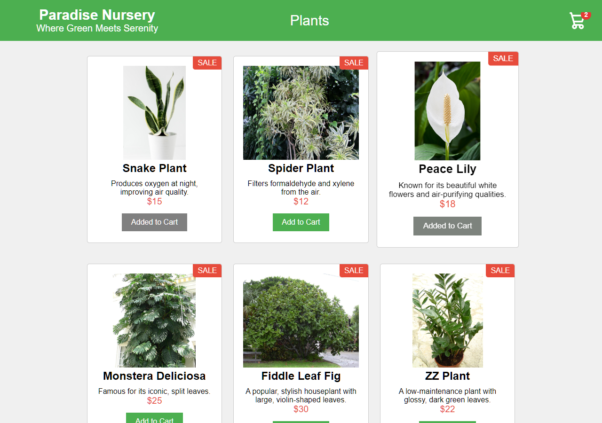
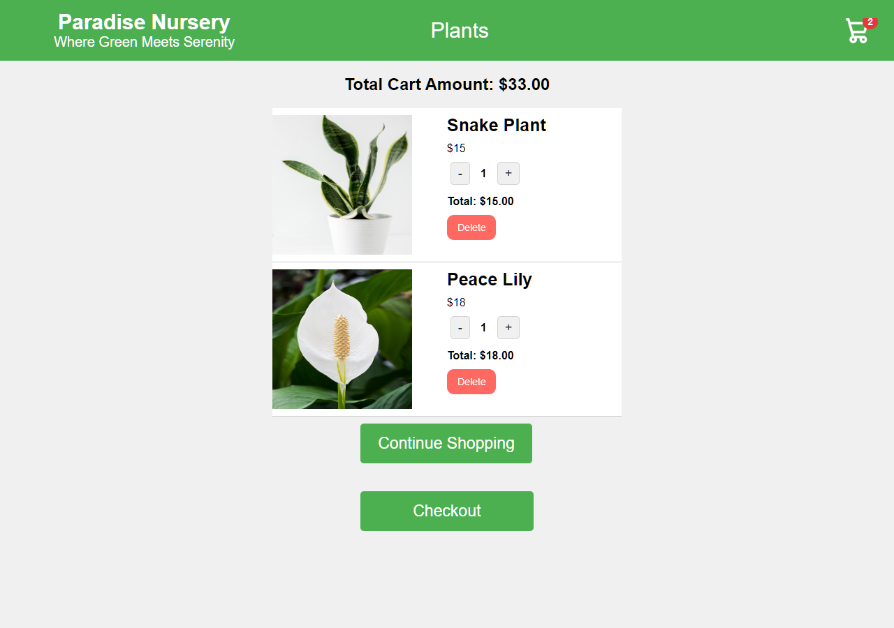

# Paradise Nursery: a plant shop in React and Redux

A single-page shopping app for a house-plant nursery: a landing page, a catalogue of house plants, and a shopping cart whose state lives in a Redux store.

**Live demo:** https://engomaressam.github.io/e-plant-shopping/

Final project for IBM's *Developing Front-End Apps with React* course, built on the course's starter template.



## What it does

- **Landing page** with a *Get Started* button and an *About us* section.
- **Catalogue** of six plants, each with a photo, a description and a price.
- **Add to cart**: the button turns grey and reads "Added to Cart" while the plant is in the cart, and the badge on the cart icon shows the number of items.
- **Cart page**: increase or decrease quantities, delete a plant, see each line's subtotal and the cart total, then continue shopping or check out (checkout is a placeholder).



## How it is built

- React 18 function components with hooks, bundled by Vite.
- Redux Toolkit: `CartSlice.jsx` holds the cart with three reducers (`addItem`, `removeItem`, `updateQuantity`). The catalogue dispatches `addItem`; the cart page dispatches the other two; the navigation bar and the catalogue's buttons read the cart with `useSelector`, so they always agree with it.
- Deployed by GitHub Actions (`.github/workflows/deploy.yml`): every push to `main` builds the app and publishes `dist/` to GitHub Pages.

## Run it locally

```bash
npm install
npm run dev          # http://localhost:5173/e-plant-shopping/
npm run build        # production build in dist/
```

## History

Built in August 2025 on another GitHub account and moved here in October 2026 with its full commit history (the early commits are the IBM template's). The move fixed what had stopped the catalogue from showing:

- the catalogue component had been committed into `ProductList.css` instead of `ProductList.jsx`, so the page rendered an empty grid; it is back in `ProductList.jsx` and the stylesheet is restored;
- the "Added to Cart" state now comes from the Redux store instead of local component state, so it stays correct after a visit to the cart;
- four product photos whose links had stopped working were replaced with Wikimedia Commons photos of the same plants;
- the grid wraps into rows, and the cart badge is visible (a global `overflow: hidden` in the template had clipped it);
- the Vite base path matches this repository, and the app deploys itself to GitHub Pages.

## Photo credits

Snake plant, spider plant and the landing-page photos: Pixabay. From Wikimedia Commons: [Peace lily](https://commons.wikimedia.org/wiki/File:Spathiphyllum_cochlearispathum_RTBG.jpg) by JJ Harrison (CC BY-SA 3.0), [Monstera deliciosa](https://commons.wikimedia.org/wiki/File:Monstera_deliciosa2.jpg) (CC BY-SA 3.0), [Fiddle leaf fig](https://commons.wikimedia.org/wiki/File:Starr_031108-0130_Ficus_lyrata.jpg) by Forest and Kim Starr (CC BY 3.0), [ZZ plant](https://commons.wikimedia.org/wiki/File:Zamioculcas_zamiifolia_1.jpg) by WeFt (CC BY-SA 3.0).

---

Omar Essam El Sherbiny · [omaressam.web.app](https://omaressam.web.app) · [LinkedIn](https://www.linkedin.com/in/omar-essam-el-sherbiny-b602279b/)
